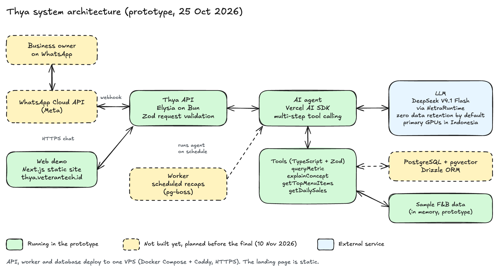

# Chapter 4: Key Features & Tech Stack

> Draft for the paper (English). Owner: Rafee. Status labels follow what the prototype runs on 25 October 2026. Check the "Status" column again right before export: the API is still being built today.
>
> Replaces the old Chapter 4 diagram and labels in Slides. The old diagram came from another project (Tauri, Express, Supabase, Midtrans, load cell). The label "LangGraph Agent: Auth - Validation - Routing" was copied from the API box by mistake, and the agent no longer uses LangGraph.

## Key features

Thya is an AI agent that a business owner talks to in plain Indonesian. The owner asks a question, and the agent decides which calculation to run, calls it, and answers in a short WhatsApp-style message. Every number in an answer comes from a tool call on the owner's data. The model is instructed not to guess figures, and to say so when the data does not exist (for example stock or payroll).

| Feature | What the owner can do | Status |
|---|---|---|
| Ask about a business number | "Omzet minggu ini berapa?" returns one metric (revenue, cost of goods sold, gross profit, gross margin, or items sold) with the change against the previous period of the same length. Everyday words are mapped to a defined metric: "untung" is answered as gross profit, and the answer says so, because operating costs are not recorded yet | Working in the prototype, on sample data |
| Plain-language explanations | Thya explains each metric in plain language using the owner's own numbers, and answers "apa itu HPP?" or "maksudnya?" with the same numbers. The explanation text comes from fixed templates in code, not from the model, so every figure still comes from a tool | Working in the prototype, on sample data |
| Best and worst menu items | Rank menu items by revenue, quantity, or gross profit for any period | Working in the prototype, on sample data |
| Daily trend | Revenue and items sold per day for up to 31 days, to spot busy and quiet days | Working in the prototype, on sample data |
| Web demo | A WhatsApp-style chat page on the landing site that calls the same agent as the real channel | Working in the prototype |
| Chat on WhatsApp | The same agent answers through the WhatsApp Business Platform (Cloud API) | Planned before the final (test number) |
| Scheduled recap | "Tiap hari buatin rekapan ya" saves a schedule, and a background worker sends the recap every day | Planned before the final |
| Spreadsheet connection | Read an owner's existing sales spreadsheet instead of retyping it | Planned before the final |
| Net profit and operating costs | Record rent, wages, and other operating costs so Thya can answer net profit. Today Thya replies that this data is not available yet and gives no number | Roadmap |
| Record a transaction by chat | "Tadi beli gula 2 kg 36 ribu" saves an expense | Roadmap |

The prototype uses one sample business, Kopi Senja, a coffee shop in Yogyakarta with 11 menu items. Its sales history is generated, not real customer data. We chose food and beverage (F&B) as the first segment because its data has a regular shape: sales per menu item, ingredient cost, and operating expenses.

## System architecture

Boxes with a dashed border are not built yet. Arrows show the request path.

1. **Channels.** The owner chats on WhatsApp. Meta's WhatsApp Cloud API forwards each message to our webhook over HTTPS and delivers our reply. For judges and visitors, the web demo sends the same kind of chat request to the API.
2. **Thya API.** One Elysia server running on Bun receives webhooks and demo requests. It validates every request body with Zod before the agent sees it, and it rejects client-supplied system prompts.
3. **AI agent.** The agent is a loop of LLM calls and tool calls, built with the Vercel AI SDK. The model picks a tool, the SDK runs it, and the result goes back to the model. The loop stops after at most 5 steps. Tool inputs have Zod schemas, so a malformed call from the model fails validation instead of running.
4. **Tools.** Each tool is a plain TypeScript function with a typed input. The prototype has four: `queryMetric` (one defined metric per call, with its comparison and plain-language explanation), `explainConcept` (what a term such as HPP or gross margin means, shown with the owner's numbers), `getTopMenuItems`, and `getDailySales`. Metric definitions live in one module, so the same word always maps to the same calculation. Planned tools include `addTransaction`, `readSpreadsheet`, and `createSchedule`.
5. **LLM.** DeepSeek V4.1 Flash, served by NetraRuntime through an OpenAI-compatible endpoint. NetraRuntime has zero data retention by default and runs its primary GPU infrastructure in Indonesia. One module (`llm.ts`) is the only code that knows the provider, so we can switch models without touching the agent.
6. **Data.** One PostgreSQL database with the pgvector extension, accessed through Drizzle ORM. It will hold businesses, users (WhatsApp numbers), message history, transactions, and schedules. pgvector covers document search, so we do not run a separate vector database. In the prototype the agent reads generated sample data in memory instead.
7. **Worker.** A second entrypoint from the same codebase checks due schedules and runs the agent to write each recap. pg-boss provides the job queue and cron on top of the same Postgres, so no Redis is needed.

## Tech stack

| Layer | Technology | Why we chose it |
|---|---|---|
| Messaging channel | WhatsApp Business Platform (Cloud API) | Our users already use WhatsApp every day, so there is no new app to install |
| Landing page and demo | Next.js, exported as static HTML, served on a .id domain (`thya.veterantech.id`) | The landing page needs no server; the demo page only calls the API |
| API | Elysia on Bun, TypeScript | Small, fast HTTP server; one codebase for the server and the worker |
| Agent | Vercel AI SDK (`ai`), multi-step tool calling | Our flow is "question, tool, answer" without branching approvals, so a graph framework is not needed yet |
| Validation | Zod | One schema language for request bodies, webhook payloads, and tool inputs |
| LLM | DeepSeek V4.1 Flash via NetraRuntime | Zero data retention by default and primary GPU infrastructure in Indonesia, which matters for business financial data under Law No. 27/2022 on Personal Data Protection (UU PDP) |
| Database | PostgreSQL + pgvector, Drizzle ORM | Relational data and embeddings in one database |
| Scheduling | pg-boss | Cron and retries backed by the existing Postgres |
| Hosting | API, worker, and database on a VPS with Docker Compose and Caddy (automatic HTTPS); landing page on static hosting | WhatsApp webhooks require a valid HTTPS endpoint |
| Monorepo and quality | Bun workspaces, Turborepo, `bun test`, Oxlint | Unit tests cover the sales calculations, metric definitions, and tool logic |

## Data protection

- Once the database is live, business data and chat history are stored only in our own Postgres instance. The LLM receives only the current conversation and tool results.
- The LLM provider has zero data retention by default and runs its primary GPU infrastructure in Indonesia.
- The web demo uses generated sample data only. No real business data is used in the prototype.

<!--
Open items before export (remove this comment from the paper):
- Do not claim that data stays in Indonesia. NetraRuntime's data-handling policy (https://netraruntime.com/policies/data-handling) says ZDR does not guarantee processing stays in Indonesia and mentions external inference routes and fallback processing.
- Netra's cache is shared across customers, with a per-workspace opt-out. Opt the Thya workspace out before claiming anything about caching.
- Confirm VPS region (Jakarta or Singapore) before writing where the database runs.
- Confirm the "Status" column against the deployed demo on the day of export.
- NetraRuntime zero-retention claim: cite https://netraruntime.com/policies/data-handling in the Reference chapter.
-->
